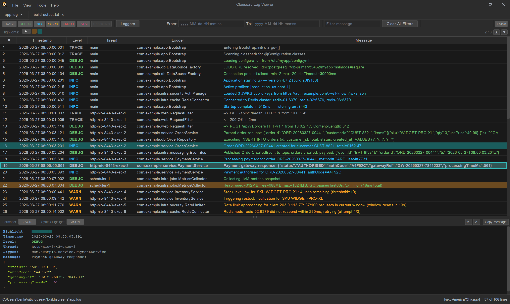
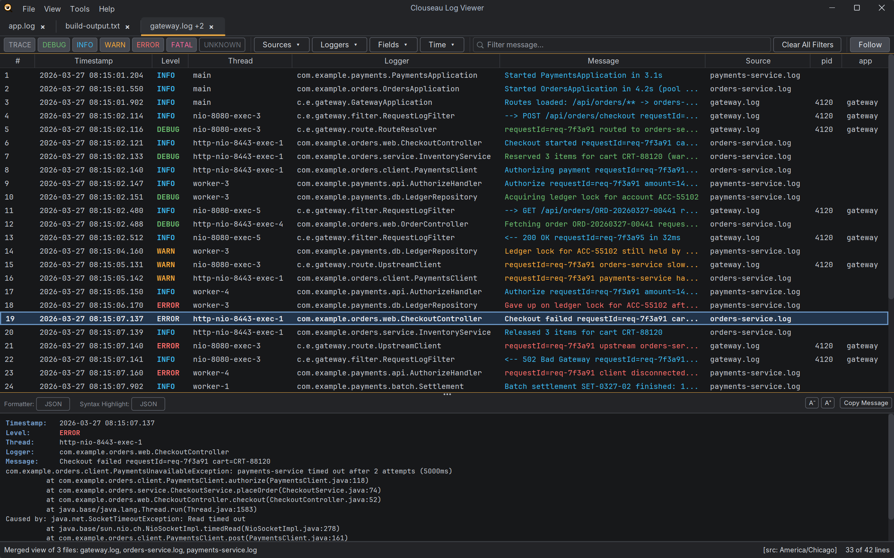

# Clouseau Log Viewer

A log viewer for software engineers, born from a love of OtrosLogViewer and a desire to bring its core functionality into a cleaner, more modern interface. Open logs of any size, merge the logs of several services into one timeline, filter in milliseconds, and hand your annotated findings to a colleague in one file.

**[Download](#download)** · **[User Guide](https://benlazaro.github.io/clouseau/guide/)** · **[For developers](https://benlazaro.github.io/clouseau/guide/developers.html)**

---

*Level colors, row highlights with the bar for jumping between them, and the detail panel pretty-printing a JSON payload.*

*Three services' logs, in two formats, interleaved into one timeline. The **Source** column shows which file each line came from.*

---

## Features

- **Any file size** — every file is indexed on disk rather than loaded into memory, at about 29 bytes of heap per line, so a 1M-line, 125 MB log uses under 50 MB. Lines are never dropped from a file you open. [More](https://benlazaro.github.io/clouseau/guide/opening-files.html#large-files)
- **Multi-format parsing** — Log4j pattern and Spring Boot built in, auto-detected on open; add your own formats in the parser editor, without code. [More](https://benlazaro.github.io/clouseau/guide/parsers.html)
- **Merged views** — open several logs as one timeline, interleaved by timestamp: the rolled files of one app, or the logs of several services. Formats can be mixed, each file can have its own parser and timezone, and a file whose clock is off can be shifted into place. [More](https://benlazaro.github.io/clouseau/guide/merged-views.html)
- **Several windows** — move tabs into their own windows to watch logs on more than one monitor; a moved tab keeps following without reloading. [More](https://benlazaro.github.io/clouseau/guide/opening-files.html#several-windows)
- **Pick up where you left off** — Clouseau reopens your windows and tabs, with their filters, the next time it starts, and named sessions keep one set of logs per project to switch between. [More](https://benlazaro.github.io/clouseau/guide/opening-files.html#picking-up-where-you-left-off)
- **Compressed files** — open `.gz` and `.zip` files directly; for a zip with several logs, tick the ones you want, in separate tabs or merged. [More](https://benlazaro.github.io/clouseau/guide/opening-files.html#compressed-files)
- **Plain text fallback** — a file no parser recognizes opens as plain text, with an offer to create a parser for it. [More](https://benlazaro.github.io/clouseau/guide/opening-files.html#files-no-parser-recognizes)
- **Filtering and Find** — by level, logger, field, time range and text, combined; level, logger and time filters take milliseconds even on a million lines. `Ctrl+F` searches every column. [More](https://benlazaro.github.io/clouseau/guide/reading-and-filtering.html)
- **Highlights** — color-code rows for triage and jump between them by color. [More](https://benlazaro.github.io/clouseau/guide/reading-and-filtering.html#highlights)
- **Detail panel** — the full entry with its stack trace, and JSON payloads pretty-printed and syntax-highlighted. [More](https://benlazaro.github.io/clouseau/guide/reading-and-filtering.html#the-detail-panel)
- **Notes** — annotate lines while you investigate; notes are saved next to the log and come back whenever anyone opens it. [More](https://benlazaro.github.io/clouseau/guide/annotations-and-review.html)
- **Review bundles** — `File → Export for Review…` packs the log (or every file of a merged view) and its notes into one `.zip` for a colleague, who opens it like any log. [More](https://benlazaro.github.io/clouseau/guide/annotations-and-review.html#exporting-for-review)
- **Follow mode** — tail a live file like `tail -f`, locally or over SSH; survives log rotation without losing rows. Remote tabs show whether they are connected and reconnect with `Ctrl+R`. [More](https://benlazaro.github.io/clouseau/guide/following.html)
- **Columns and layouts** — hide, reorder and size columns, and save named layouts. [More](https://benlazaro.github.io/clouseau/guide/reading-and-filtering.html#columns)
- **Themes** — Dark and Light built in, plus any FlatLaf theme you install, switched live. [More](https://benlazaro.github.io/clouseau/guide/settings.html#themes)
- **Plugins** — add parsers, formatters, syntax highlighters or live log sources from a JAR, or install them from a Nexus or Maven Central repository. [More](https://benlazaro.github.io/clouseau/guide/settings.html#plugins)

---

## Download

| | |
|---|---|
| **Windows** | [Latest release](https://github.com/benlazaro/clouseau/releases) → `clouseau-<version>-windows.zip` |
| **macOS** | [Latest release](https://github.com/benlazaro/clouseau/releases) → `clouseau-<version>-macos.zip` |
| **Linux** | [Latest release](https://github.com/benlazaro/clouseau/releases) → `clouseau-<version>-linux.zip` |
| **Edge** | [⬇ clouseau-edge.jar](https://github.com/benlazaro/clouseau/releases/download/edge/clouseau-edge.jar), built from the latest commit on `main` |

Each release's zip is portable and brings its own Java runtime: unzip it and run the
launcher (`Clouseau.exe` on Windows). Releases are pre-releases while the plugin API
settles. The Edge build is a single jar for trying the newest changes; run it with
`java -jar clouseau-edge.jar` on Java 21 or later. Clouseau tells you when a new release
is out; [Settings → Updates](https://benlazaro.github.io/clouseau/guide/settings.html#new-versions)
turns that off.

## Getting started

Download Clouseau as above, then open a log with `File → Open…` (`Ctrl+O`) or drag it onto the window. The [User Guide](https://benlazaro.github.io/clouseau/guide/) covers everything else.

To build Clouseau yourself or write a plugin, see [For developers](https://benlazaro.github.io/clouseau/guide/developers.html).

---

## License

MIT
