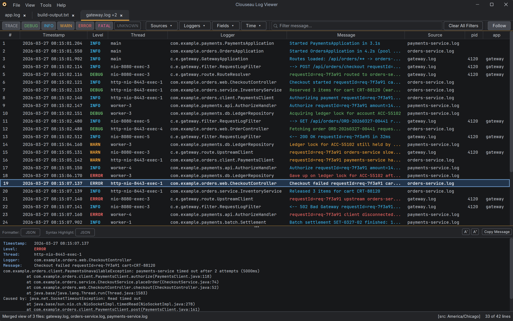

# Merged views
{: .no_toc }

A merged view shows several logs as one timeline, with every line in time order. Use it
for the rolled files of one app (`app.log`, `app.log.1`, `app.log.2.gz`), or to follow one
request or incident across the logs of several services or servers.

1. TOC
{:toc}

## Opening a merged view

Any of these opens several files as one view:

- Select several files in the open dialog and leave **Open as** on **One merged view**.
- Drag several files onto the window, or pass several on the command line, then choose
  **Merged View**. Tick **Remember my choice** to skip the question next time; **When
  opening several files** in [Settings](settings.md) changes it later.
- Type a pattern such as `app.log*` in the open dialog's **File Name** to open every
  matching file in that folder, merged.
- Open a `.zip` with several logs, tick the ones you want, and tick **Merge into one
  view**.

The tab is named after the first file, plus how many others there are (`gateway.log +2`),
and the status bar lists every file.

## How lines are ordered

- Lines from all files are interleaved by timestamp.
- Continuation lines, such as a stack trace, stay with their entry and are never split by
  lines from another file.
- Lines with the same timestamp keep each file's own order.
- Files can be in different formats: each is read with its own parser. Columns such as
  timestamp, level, logger and message line up for every format; extra fields get their
  own column, empty for files that don't have them.

Files whose lines have no timestamps, or that no parser recognizes, can't go on a
timeline. Clouseau lists them and offers to open each in its own tab.

## Working across files

- The **Source** column shows which file each line came from.
- **Sources** in the filter bar hides or shows whole files.
- Every other filter, Find, highlights, notes and the detail panel work across all files.
- Notes and highlights are saved with the file their line came from, so they show up again
  when you open that file on its own.

## Per-file settings

Right-click a row and use the items for that row's file, or open the tab's **Sources** menu
and pick the file:

### Set Source Timezone for …

Use this when files were written in different timezones: the timezone says how to read
that file's timestamps. Clouseau remembers it for the file.

### Set Parser for …

By default every file uses the tab's parser choice (with **Auto-detect**, each file is
detected on its own). Pick a parser here to read one file with a specific format, or
**Same as the tab** to go back. Clouseau refuses a parser that doesn't recognize the
file's first lines, since the file would drop out of the view.

### Set Time Offset for …

A file's clock can simply be wrong: by milliseconds on a server, or by minutes or hours on
a customer's device. The usual sign is effect before cause, such as a reply logged before
its request.

Enter the offset to add to that file's timestamps (choose **−** to subtract), and its lines
move to their corrected place. The Source column shows the offset, for example
`db.log (+3m 12s)`, and the time filter uses the corrected times. The detail panel still
shows the time the file itself wrote, marked **Shifted**. **No Offset** removes it.

The offset is applied after the source timezone: the timezone says how to read the
timestamps, the offset corrects a clock that's off.

## Following a merged view

With **Follow** on, every plain file in the view is followed (compressed files stay as
they are). New lines are held back for up to a second, so lines written a moment apart in
different files still land in time order. A line that arrives later than that moves to its
place, and your selection, highlights and notes stay on their lines.

A merged view follows the files it opened. It never adds files that start matching the
pattern later, since a newly rotated `app.log.1` would repeat lines already shown.

## Exporting a merged view

**File → Export for Review…** puts every file of the view in one bundle, with each file's
notes, timezone, time offset and parser. Opening the bundle brings back the same merged
view. See [Notes and review bundles](annotations-and-review.md).
