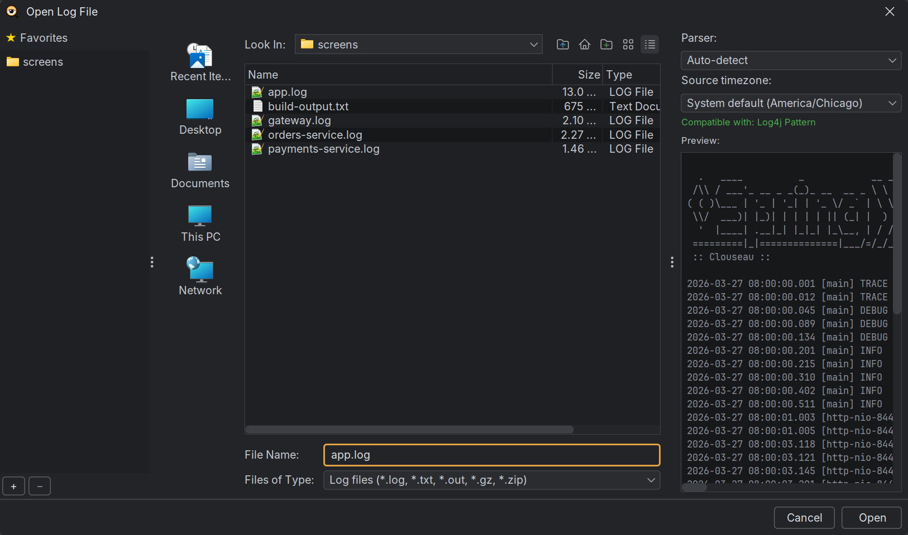
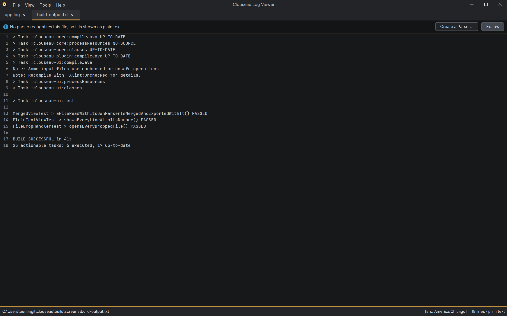

# Opening files
{: .no_toc }

1. TOC
{:toc}

## Ways to open a file

- **File → Open** (`Ctrl+O`) opens the file dialog.
- **Drag** one or more files onto the window: the table, the detail panel, the tab strip
  or the welcome screen. Folders are ignored.
- **File → Open Recent** lists the files you opened last (how many is set in
  [Settings](settings.md)).
- **"Open with"** from your file manager. The Windows, macOS and Linux installers
  associate `.log` files with Clouseau, so double-clicking one opens it. The portable zip
  doesn't register anything, so with it you pick the Clouseau launcher by hand.
- **The command line**: pass one or more file paths to the launcher.

Only one Clouseau runs at a time. Opening a file while it's running sends the file to the
window that's already open, so you never get two copies.

Each file opens in its own tab. Opening a file that's already open switches to its tab.

## The open dialog

- **Favorites** on the left: click **+** to pin the current folder, **−** to remove one.
- **Parser** on the right: leave it on **Auto-detect**, or pick a format. The status line
  under it says which parser recognizes the selected file, and the **Preview** shows its
  first lines.
- If no parser recognizes the file, the status says so in amber and **Open** still works:
  the file opens as [plain text](#files-no-parser-recognizes).
- Select several files to open them together, either in tabs or as one
  [merged view](merged-views.md).
- Type a pattern such as `app.log*` in **File Name** to open every matching file in that
  folder as one merged view.

## Compressed files

`.gz` and `.zip` files open directly, without extracting them first.

- A `.zip` with one file opens that file.
- A `.zip` with several files shows a picker: tick the files to open (there's a filter box
  and **Select all**). Tick **Merge into one view** to open them as a
  [merged view](merged-views.md); otherwise each opens in its own tab.
- A `.zip` that is a [review bundle](annotations-and-review.md#opening-a-review-bundle)
  opens its log, with its notes, without asking.

Clouseau unpacks a compressed file to a temporary copy in the `cache` folder of the
[data folder](settings.md#the-data-folder) while it reads it. You never need to clean it
up: the copy is deleted when you close the tab. If the disk fills up while unpacking,
Clouseau stops, says so, and marks the tab "partly loaded (disk full)".

## Large files

Every file is indexed rather than held in memory: Clouseau keeps about 29 bytes per line
and reads the text back from disk when it's shown. A 1-million-line, 125 MB log uses under
50 MB of memory, and no line of a file you open is ever dropped.

In the rare case that even the index fills the memory (tens of millions of lines),
Clouseau stops reading, tells you how many lines it loaded, and marks the tab "partly
loaded (low memory)". See [Memory](settings.md#memory) to raise the limit.

## Files no parser recognizes

If no parser recognizes the first 50 lines of a file, it opens anyway, as read-only plain
text: every line with its line number, Find (`Ctrl+F`), copy, and **Follow** for a file
that's still growing.

Click **Create a Parser…** in the banner to open the [parser editor](parsers.md) with a new
parser and the file's first line as a sample. When you save a parser that recognizes the
file, the tab switches to the normal table.

If a file looks binary rather than text, Clouseau asks before showing it.

## Tabs

- `Ctrl+Tab` / `Ctrl+Shift+Tab`, or `Ctrl+PageDown` / `Ctrl+PageUp`, go to the next or
  previous tab.
- `Ctrl+1` to `Ctrl+8` jump to that tab, and `Ctrl+9` to the last one.
- Drag a tab to move it.
- `Ctrl+W` or the tab's **×** closes it. Clouseau asks first, unless you tick "Don't ask
  again" (you can turn the question back on in [Settings](settings.md)).
- Right-click a tab to set its [source timezone](reading-and-filtering.md#timezones), or
  the same timezone for every tab.

Each tab keeps its own filters, follow mode, highlights and column layout.

## Several windows

To watch logs on more than one monitor, spread your tabs across several windows:

- Right-click a tab and choose **Move to New Window**, then drag that window to another
  monitor.
- Right-click a tab and choose **Move to ▸ Window 2** (or any other open window) to send
  it there.
- Drag a tab out of its window: release it over another Clouseau window's tabs to move it
  there, or anywhere else to open it in a new window at that spot.
- **File → New Window** (`Ctrl+N`) opens an empty window. Files you open from its menu
  open in it.

A moved tab carries on as it was: following, filters, notes and Find aren't interrupted,
and nothing is reloaded. A window you empty by moving its last tab away closes itself.

Every window has the full menu bar, and the menus and shortcuts act on the window you're
in, and a file dropped on a window opens in that window. Files opened from outside
Clouseau (double-clicking a file, "Open with") open in the window you used last. A file can only be open once: opening it
again brings its window to the front and selects its tab.

Closing a window closes its tabs. Clouseau asks first, as it does for a tab, unless you
turned that question off. Closing the last window quits Clouseau, without asking, as
before.

## Picking up where you left off

When you quit Clouseau and start it again, it reopens what you had open: every window
in its place, with the same tabs in the same order and the same tab selected. Each tab
comes back as you left it: the same file or files, parser, timezone, time offsets,
follow mode, columns and filters. This works for files, merged views, review bundles,
SSH connections and plugin sources, and it is saved as you work, so it survives a crash
or a restart for updates too.

- **Only the tabs in front load straight away.** The others say *"Opens when you select
  this tab"* and load when you select them, so a large session starts quickly.
- **Restored filters are announced.** A tab whose filters came back shows a strip above
  the filter bar, for example *"Filters restored from your last session: levels, 1
  logger."*, with **Clear filters** to show everything again. It also warns when a time
  range will hide new lines of a log you're following. The strip goes away when you
  change a filter or close it.
- **Passwords aren't saved in sessions.** An SSH tab reconnects by itself if it needs no
  password, or if you saved its password with an SSH connection to the same host, port
  and user. Otherwise it shows **Reconnect…**, which opens the SSH dialog filled in so
  you only type the password. Plugin sources work the same way.
- **Nothing disappears.** A file that isn't there any more (a drive that isn't connected,
  a log that was deleted) gets a tab that says so, with **Try Again**.
- **A missing monitor is fine.** A window that was on a monitor that isn't connected
  opens on your main screen instead. It goes back to the other monitor the next time it's
  connected, unless you moved the window in the meantime.
- **File → Exit saves every window.** Closing windows one at a time takes each one out
  of the session, so only the last one comes back.

Files you open with "Open with" or on the command line open alongside the restored
session. To start with an empty window instead, choose **Start empty** under
[Settings → On startup](settings.md#settings).
