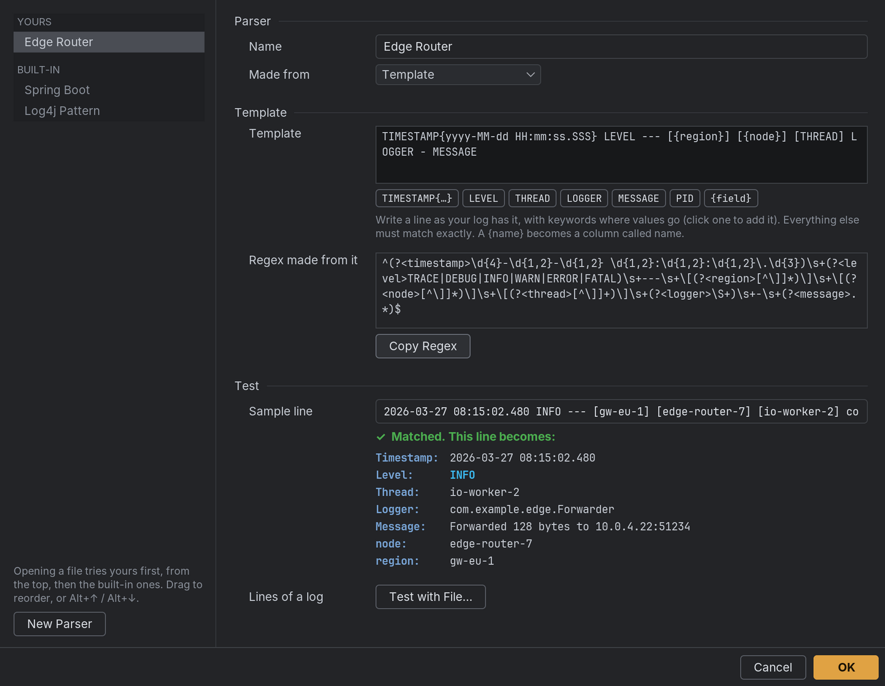

# Parsers
{: .no_toc }

A parser turns a log line into columns: timestamp, level, thread, logger, message and any
extra fields. Clouseau picks one automatically from a file's first lines; you can also
choose one in the open dialog.

1. TOC
{:toc}

## Built-in formats

### Log4j Pattern

Pattern: `%d{yyyy-MM-dd HH:mm:ss.SSS} [%t] %-5level %logger - %msg`

```
2024-01-15 10:30:45.123 [main] INFO  com.example.App - Application started
2024-01-15 10:30:45,456 [http-nio-8080-exec-1] ERROR com.example.OrderService - Order not found
2024-01-15T10:30:46.001 [scheduler-1] WARN  com.example.Cache - Cache miss rate high
```

A space or `T` may separate the date and time, and `.` or `,` the milliseconds.

### Spring Boot

The default Logback console format, before and since Spring Boot 3.4 (which adds the
application name):

```
2024-01-15T10:30:45.123+01:00  INFO 12345 --- [           main] com.example.App           : Started App in 2.3s
2025-06-10T23:43:06.269-05:00  INFO 31280 --- [demo] [  restartedMain] com.example.App           : Started App in 1.8s
```

The process ID and application name become **pid** and **app** columns.

## The parser editor

**Tools → Parser Editor…** lists the parsers in a sidebar: **Yours** first, then the
**Built-in** ones. Type in **Filter parsers…** above the list to find one by name, and drag
the divider to make the sidebar wider; the editor remembers its size and the divider. When
Clouseau opens a file it tries yours from the top, then the built-in ones, and uses the
first that reads the line, so put the more specific parsers higher: drag one up or down, or
select it and press `Alt`+`↑` / `Alt`+`↓`.

Click **New Parser** to add one. On the row under the mouse, the duplicate icon (`Ctrl`+`D`)
copies a parser and the trash can (`Delete`) removes one of yours. Built-in parsers can't be
changed: duplicate one to make your own from it.



Each parser has a **Name**, which no other parser may use, and is **Made from** one of:

- **Template** (the easiest): write the line with keywords where the values go. Click a
  keyword under the field to add it where the cursor is.
- **Logback / Log4j pattern**: paste the pattern from your logging configuration, such as
  `%d{yyyy-MM-dd HH:mm:ss.SSS} [%thread] %-5level %logger - %msg%n`.
- **Regex**: a Java regular expression with named groups, and the **Timestamp format**,
  for formats the other two can't describe.

For a template or a pattern, **Regex made from it** shows what Clouseau will match; **Copy
Regex** copies it, for example to start a Regex parser. A problem shows in red under the
field it's about, such as `Timestamp format: Unknown pattern letter: b.`, and the parser
gets a red dot in the sidebar. **OK** saves everything at once; if a parser still has a
problem, OK selects it and shows the problem on its field instead.

Under **Test**, a **Sample line** shows whether it matches and what it becomes, as the
detail pane would show it: the time in your display time zone, the level in its color, and
any extra fields. **Test with File…** tries the parser on the first 500 lines of a log and
says how many matched, counting stack-trace lines apart since they continue the entry
above. The first line that should have matched and didn't is shown, and **Use as Sample**
makes it the sample so you can fix the parser for it.

**OK** saves every parser at once; a parser with a problem is shown instead, and nothing is
saved until it's fixed. **Cancel**, `Esc` or closing the window asks first if anything
changed.

### Template keywords

Keywords are uppercase. Everything between them must appear in the line as written.

| Keyword | Matches |
|---|---|
| `TIMESTAMP{format}` | The timestamp, read with a [`DateTimeFormatter`](https://docs.oracle.com/en/java/javase/21/docs/api/java.base/java/time/format/DateTimeFormatter.html) pattern such as `TIMESTAMP{yyyy-MM-dd HH:mm:ss.SSS}`. Required. |
| `LEVEL` | `TRACE`, `DEBUG`, `INFO`, `WARN`, `ERROR` or `FATAL` |
| `LOGGER` | The logger name (no spaces) |
| `THREAD` | The thread name, up to a closing bracket |
| `PID` | A process ID (digits) |
| `MESSAGE` | The rest of the line |
| `{name}` | Any other value, up to a closing bracket, shown in its own column, e.g. `{request_id}` |

For example, the template

```
TIMESTAMP{yyyy-MM-dd HH:mm:ss.SSS} [{instance_id}] [THREAD] LEVEL LOGGER - MESSAGE
```

matches

```
2024-01-15 10:23:45.123 [550e8400-e29b] [main] INFO  com.example.App - Server started
```

### From a file no parser recognizes

When a file opens as [plain text](opening-files.md#files-no-parser-recognizes), **Create a
Parser…** opens the editor with a new parser, the file's first line as the sample, and its
first lines already loaded for the file test, which updates as you edit. Saving a parser
that recognizes the file switches the tab to the table.

## parsers.json

Your parsers are saved in `parsers.json` in the [data folder](settings.md#the-data-folder).
You can also edit it by hand, as a JSON array; restart Clouseau afterwards. Its parsers are
tried in the file's order, before the built-in ones; one with the same name as a built-in
parser replaces it.

```json
[
  {
    "name": "My App",
    "pattern": "(?<timestamp>\\d{4}-\\d{2}-\\d{2} \\d{2}:\\d{2}:\\d{2}) \\[(?<thread>[^\\]]+)\\] (?<level>\\w+) (?<logger>\\S+) - (?<message>.*)",
    "timestampFormat": "yyyy-MM-dd HH:mm:ss"
  }
]
```

| Field | Description |
|---|---|
| `name` | The name shown in parser lists |
| `pattern` | A Java regex with named groups |
| `timestampFormat` | A `DateTimeFormatter` pattern for the `timestamp` group. `ISO_OFFSET_DATE_TIME` matches timestamps with an offset or `Z`, as Spring Boot writes them. A `,` before the milliseconds is read as `.`. |

The groups `timestamp`, `level`, `logger`, `thread` and `message` fill those columns; any
other named group becomes an extra column. All groups are optional. Invalid entries are
skipped, with a warning in Clouseau's own log.

Parsers from [plugins](settings.md#plugins) come after yours and the built-in ones during
auto-detection.
