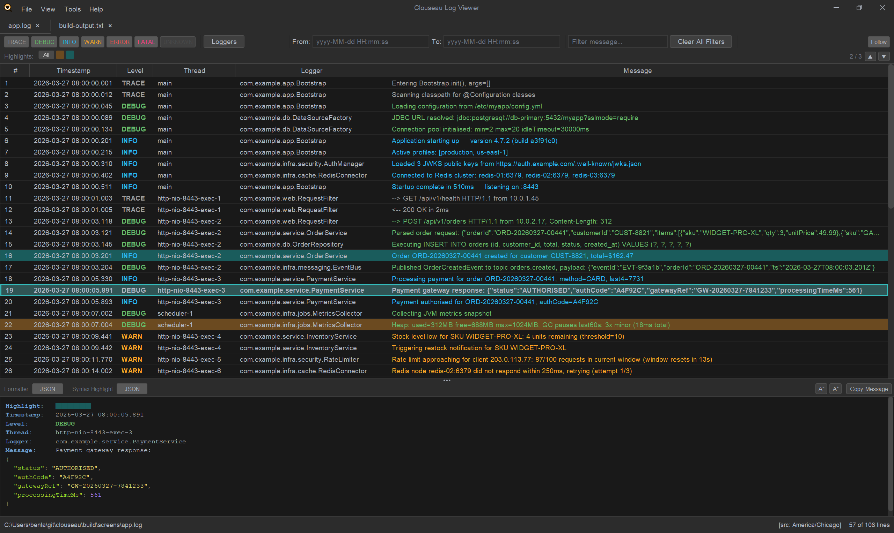
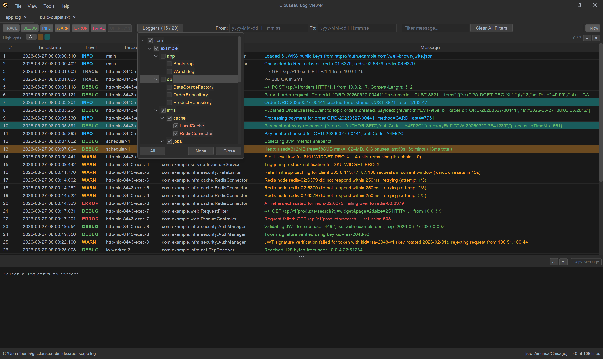

# Reading and filtering
{: .no_toc }

1. TOC
{:toc}

## The table

Each line of the log is a row with its timestamp, level, thread, logger and message. Rows
are colored by level, so errors and warnings stand out. Formats with extra fields (such as
a request ID or a process ID) get a column for each. Continuation lines, such as the lines
of a stack trace, stay with the entry they belong to.

The first column numbers the rows, and keeps each row's number when filters hide others:

- **Line**, on a file: the line in the file, as your editor counts it. Gaps are lines folded
  into the entry above (point at the number to see them, such as "Lines 66–75"), blank
  lines, or rows your filters hide.
- **#**, in a merged view: the row's place in the merged timeline. Its line in its own file
  is in the **Source** column, as `db.log:13`.
- **#**, on a live source: entries received since the tab opened.

The status bar shows the file's path, the [source timezone](#timezones), and how many rows
are shown from how many lines, such as **57 rows · 108 lines**.

- `Ctrl+Home` and `Ctrl+End` jump to the first and last row.
- Right-click a row for [highlights](#highlights), [notes](annotations-and-review.md),
  **Reload File** (read the file again from the start, also **File → Reload File**,
  `Ctrl+R`) and **Clear Table** (also **Edit → Clear Table**).
- **Clear Table** empties the table so you see only what's written from now on, for example
  while you reproduce a bug. On a file, the rows are only hidden: new rows keep their line
  numbers in the file, your notes and highlights stay, and **Reload File** brings every row
  back. On an SSH or plugin source, the rows so far are removed. It isn't available on a
  merged view or a file shown as plain text.
- The **Edit** menu has the copy commands, Find (`Ctrl+F`, then `F3` / `Shift+F3` for the
  next and previous match) and notes for the selected row. The **View** menu has Follow,
  **Detail Pane** (Wrap Lines and text size, `Ctrl+=` / `Ctrl+-`), the tab's Time Zone and
  Clear All Filters.

## The detail panel

Select a row to see the whole entry below the table: every field, the full message and
its stack trace. The panel's header says where the entry is, even with the first column
hidden: **Log entry · file line 41**, **Log entry · db.log, line 41** in a merged view, or
**Log entry · #1042 since connecting** on a live source. It also holds the panel's controls:

- **JSON** appears when the message is JSON. Pressed (the default), the message is
  pretty-printed and colored; released, it's shown exactly as logged. Plugin formats get a
  button of their own in the same way.
- **Wrap** wraps long lines to the panel's width instead of scrolling sideways (the same
  setting as in Settings).
- **Aa** opens the text size: **−** and **+** around the current size, and **Reset**. With
  the panel focused, `Ctrl`+mouse wheel, `Ctrl`+`+` and `Ctrl`+`-` change it too, and the new
  size shows briefly in the middle of the panel.
- **Copy** opens three choices: **Message** (as shown), **Raw Line** (the lines exactly as
  in the file, stack trace included) and **Entry** (every field, as shown). What you copied
  flashes, and a note in the middle of the panel confirms it, such as "Raw lines copied (10
  lines)". Shortcuts work from the table or the panel: `Ctrl`+`C` copies the message (in the
  panel, the text you've selected, if any), `Ctrl`+`Alt`+`C` the raw line and
  `Ctrl`+`Shift`+`C` the entry. Right-click in the panel offers the same choices, plus
  **Copy** for the selection.
- Drag the bar between the table and the panel to resize them. Files you open later start
  with the same split, even after a restart.

## Filters

The filter bar narrows the table. All filters combine, and **Clear All Filters** resets
them.

- **Levels**: click a level button to hide or show it. `Alt`+click a level to show only
  that level; `Alt`+click it again to show all.
- **Loggers**: a tree of every logger in the file. Untick a package or class to hide its
  lines, or use **All** and **None**. The button shows how many loggers are shown, for
  example **Loggers (15 / 20)**.
  Right-click a row for **Hide Logger** or **Show Only Logger** (its logger, or those of
  all selected rows), and **Show All Loggers**, which says how many are hidden. Showing
  them all again leaves the other filters as they are.
- **Fields**: for formats with extra fields, untick values to hide their lines, or a
  field to hide or show all its values. The button shows a dot while a field filter is
  active.
- **Sources**: in a [merged view](merged-views.md), hide whole files.

These popups work from the keyboard too: the arrow keys move between rows (Left and Right
fold and unfold), `Space` ticks or unticks the row you're on, and `Esc` closes the popup.
- **Time**: a time range. The quickest way is from the table: right-click a line and
  choose **Show From This Line** or **Show Up to This Line**; do both to bracket an
  incident. Or click **Time** and fill in **From**, **To** or both, then press **Apply**
  or `Enter`; an empty field leaves that end open, and **Selected row** next to a field
  fills in the selected line's time. You can type:
  - just a time, `10:00` or `10:00:05` (with or without `.SSS` milliseconds), which means
    that time on the day the log starts;
  - a date and time, `yyyy-MM-dd HH:mm` or `yyyy-MM-dd HH:mm:ss`, or just a date;
  - a span counted from the other end: `+5m` in **To** means five minutes after **From**,
    and `-90s` in **From** means 90 seconds before **To** (`ms`, `s`, `m`, `h`, `d`).

  While a range is set, the button shows it, for example **10:00:00 → 10:15:00**;
  **Clear** in the same popup removes it, and so does **Show All Times** when you
  right-click a line (it names the range it drops).
- **Filter message…**: show only lines containing the text, in any column. The **×** at
  its right end clears it.

Level, logger, field and time filters take milliseconds even on a million lines. A text
filter reads the text of the remaining rows in the background; the status bar shows
"filtering n%" while it runs, and you can keep working.

## Find

`Ctrl+F` (**Edit → Find…**) opens the find bar. It searches every column of the rows the filters show.

- `Enter`, `F3` or **▼** goes to the next match, `Shift+Enter`, `Shift+F3` or **▲** to the
  previous one. `F3` works from the table too.
- Each match is marked with a light box around the matching text, in every column, so a
  highlighted row keeps its color and still shows what matched. A short bar at the
  table's left edge marks every matching row, including one that matched only in a
  column you've hidden.
- The counter shows how many rows match ("Searching n%" while it's still counting).
- **Highlight ⌄** colors every match at once: pick one of the [highlight](#highlights)
  colors (a white ring marks the color they all have already), or **Clear Highlight** to
  uncolor them. Only rows the filters show are matched, so only those are colored.
- `Escape` closes the bar.

## Highlights

Highlights mark rows you want to come back to.

1. Select one or more rows, right-click, and pick a color.
2. The **Highlights** bar appears above the table. Click a color to step through only
   that color (or **All**), and use **▲** and **▼** to go to the previous or next
   highlighted row.
3. **Clear highlight** removes the color from the selected rows; **Clear all highlights**
   in the same menu, or **Clear Highlights** at the right end of the bar, removes every
   highlight in the tab, the ones the filters hide included (after asking, unless you
   turned that off in Settings).

Filters don't remove highlights, they only hide them. The bar stays while any row is
highlighted and says how many the filters hide: **2 / 4 · 3 hidden**, or **3 hidden by
filters** when none show (▲ and ▼ then have nowhere to go). A color whose rows are all
hidden shows a faded chip; point at a chip for its count.

Highlights are saved with the file's [notes](annotations-and-review.md), so they're back
when you open the file again, and they travel in review bundles. Each color follows the
current theme.

## Columns

Right-click any column header:

- **Columns**: tick or untick a column to show or hide it. **Show all columns** brings
  every column back.
- **Save current layout…** saves the order, visibility and width of the columns under a
  name. Pick a saved layout in the same menu to apply it.
- **Manage layouts…** deletes layouts, and sets one as the **default**, applied to every
  file you open. The default is marked ★. A layout fits merged views too: their extra
  Source column doesn't throw the other columns out of place.

Drag a column header to move the column. Columns size themselves to their content when a
file opens.

## Timezones

Log timestamps usually don't say which timezone they're in. Each tab has a **source
timezone**, used to read its timestamps; it starts as your computer's timezone and is
shown in the status bar as `[src: …]`. Click that label, or right-click the tab, to change
it. Right-click a tab and choose **Set Source Timezone for All Tabs…** to change every tab.

**Display timezone** in [Settings](settings.md) is a different thing: the timezone
timestamps are *shown* in, and the one the **Time** filter's **From** and **To** use.
