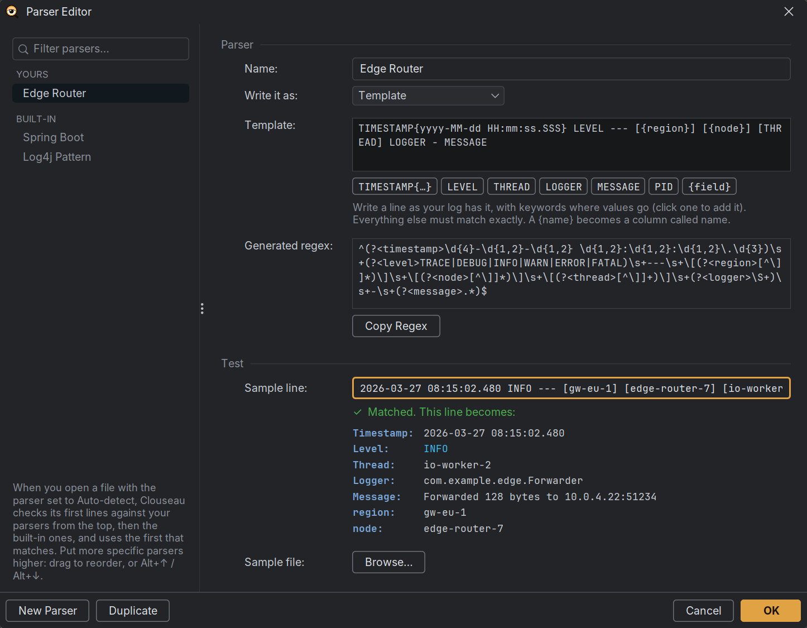

# Parsers
{: .no_toc }

A parser turns a log line into columns: timestamp, level, thread, logger, message and any
extra fields. Clouseau picks one automatically from a file's first lines; you can also
choose one in the open dialog.

1. TOC
{:toc}

## Built-in formats

### Log4j Pattern

Pattern: `%d{yyyy-MM-dd HH:mm:ss.SSS} [%t] %-5level %logger - %msg`

```
2024-01-15 10:30:45.123 [main] INFO  com.example.App - Application started
2024-01-15 10:30:45,456 [http-nio-8080-exec-1] ERROR com.example.OrderService - Order not found
2024-01-15T10:30:46.001 [scheduler-1] WARN  com.example.Cache - Cache miss rate high
```

A space or `T` may separate the date and time, and `.` or `,` the milliseconds.

### Spring Boot

The default Logback console format, before and since Spring Boot 3.4 (which adds the
application name):

```
2024-01-15T10:30:45.123+01:00  INFO 12345 --- [           main] com.example.App           : Started App in 2.3s
2025-06-10T23:43:06.269-05:00  INFO 31280 --- [demo] [  restartedMain] com.example.App           : Started App in 1.8s
```

The process ID and application name become **pid** and **app** columns.

### JSON Lines

One JSON object per line, as written by Logback's and Log4j's JSON layouts, Elastic Common
Schema (ECS), Serilog, pino, bunyan, zap, structlog, Python's JSON formatters and Docker's
`json-file` driver:

```
{"@timestamp":"2024-01-15T10:30:45.123+01:00","level":"WARN","logger_name":"com.example.Api","thread_name":"main","message":"Slow response","requestId":"r-17"}
{"level":50,"time":1705311045123,"pid":7,"hostname":"web-1","msg":"Payment failed"}
{"time":"2024-01-15T10:30:45Z","log":{"level":"error","logger":"db"},"message":"Connection lost"}
```

Clouseau finds the columns under their usual names, whatever their case: the time in
`@timestamp`, `timestamp`, `time` or `ts` (as text, or as a number of seconds or
milliseconds), the level in `level`, `severity` or `@l` (as a name, or pino's numbers),
the message in `message`, `msg` or `@m`, plus the logger and thread. ECS's nested keys
(`"log": {"level": …}`) work too. Every other key becomes a column of its own, so
`requestId` above can be filtered like any field. A stack trace in its own key
(`stack_trace`, `exception`…) is added to the message, so the detail panel shows it with
its frames linked to the code; the table shows the message's first line. A line without a
level is shown as INFO.

A line is read as JSON Lines only if it is a JSON object with a time, level or message.

### Syslog

Syslog messages as they travel over the network, in both the current format (RFC 5424) and
the older BSD one (RFC 3164):

```
<34>1 2024-01-15T10:30:45.003Z web-1 sshd 812 ID47 - Failed password for root
<11>Jan 15 10:30:45 web-1 nginx[812]: upstream timed out
```

The level comes from the priority at the start (`<34>`): emergency, alert and critical are
FATAL, notice is INFO. The app name is the logger and its process ID the thread; **host**
and **facility** are columns, with the message ID and structured data when a message has
them. A BSD time has no year, so Clouseau uses the current one (or last year's, for a date
that would be in the future). Lines without a priority, such as those in
`/var/log/syslog`, aren't read as syslog.

JSON Lines and Syslog are written in code rather than as patterns, so the parser editor
doesn't list them; you can still choose them in the open dialog. A parser of yours with
the same name replaces one.

## The parser editor

**Tools → Parser Editor…** lists the parsers in a sidebar: **Yours** first, then the
**Built-in** ones. Type in **Filter parsers…** above the list to find one by name, and drag
the divider to make the sidebar wider; the editor remembers its size and the divider. It
opens with nothing selected: pick a parser to see its pattern and test it. When
you open a file with the parser set to **Auto-detect** in the Open dialog,
Clouseau checks the file's first lines against your parsers from the top, then the built-in
ones, and uses the first that matches, so put the more specific parsers higher: drag one up or down, or
select it and press `Alt`+`↑` / `Alt`+`↓`.

Click **New Parser**, at the bottom left of the editor, to add one, or **Duplicate** beside it
(`Ctrl`+`D`) to copy the selected parser. The row under the mouse has the same duplicate icon
and a trash can (`Delete`) that removes one of yours, and right-clicking a row offers
Duplicate, Move Up, Move Down and Delete. Built-in parsers can't be changed: duplicate one to
make your own from it.



Each parser has a **Name**, which no other parser may use. **Write it as** picks how you
describe the line:

- **Template** (the easiest): write the line with keywords where the values go. Click a
  keyword under the field to add it where the cursor is.
- **Logback / Log4j pattern**: paste the pattern from your logging configuration, such as
  `%d{yyyy-MM-dd HH:mm:ss.SSS} [%thread] %-5level %logger - %msg%n`.
- **Regex**: a Java regular expression with named groups, and the **Timestamp format**,
  for formats the other two can't describe.

For a template or a pattern, **Generated regex** shows what Clouseau will match; **Copy
Regex** copies it, for example to start a Regex parser. A problem shows in red under the
field it's about, such as `Timestamp format: Unknown pattern letter: b.`, and the parser
gets a red dot in the sidebar. **OK** saves everything at once; if a parser still has a
problem, OK selects it and shows the problem on its field instead.

Under **Test**, a **Sample line** shows whether it matches and what it becomes, as the
detail pane would show it: the time in your display time zone, the level in its color, and
any extra fields. **Sample file**'s **Browse…** tries the parser on the first 500 lines of a
log and says, after the file's name, how many matched, counting stack-trace lines apart
since they continue the entry above. The result updates as you edit the parser. The first line that should have matched and didn't is shown, and **Use as Sample**
makes it the sample so you can fix the parser for it.

**OK** saves every parser at once; a parser with a problem is shown instead, and nothing is
saved until it's fixed. **Cancel**, `Esc` or closing the window asks first if anything
changed.

### Template keywords

Keywords are uppercase. Everything between them must appear in the line as written.

| Keyword | Matches |
|---|---|
| `TIMESTAMP{format}` | The timestamp, read with a [`DateTimeFormatter`](https://docs.oracle.com/en/java/javase/21/docs/api/java.base/java/time/format/DateTimeFormatter.html) pattern such as `TIMESTAMP{yyyy-MM-dd HH:mm:ss.SSS}`. Required. |
| `LEVEL` | `TRACE`, `DEBUG`, `INFO`, `WARN`, `ERROR` or `FATAL` |
| `LOGGER` | The logger name (no spaces) |
| `THREAD` | The thread name, up to a closing bracket |
| `PID` | A process ID (digits) |
| `MESSAGE` | The rest of the line |
| `{name}` | Any other value, up to a closing bracket, shown in its own column, e.g. `{request_id}` |

For example, the template

```
TIMESTAMP{yyyy-MM-dd HH:mm:ss.SSS} [{instance_id}] [THREAD] LEVEL LOGGER - MESSAGE
```

matches

```
2024-01-15 10:23:45.123 [550e8400-e29b] [main] INFO  com.example.App - Server started
```

### From a file no parser recognizes

When a file opens as [plain text](opening-files.md#files-no-parser-recognizes), **Create a
Parser…** opens the editor with a new parser, the file's first line as the sample, and its
first lines already loaded for the file test, which updates as you edit. Saving a parser
that recognizes the file switches the tab to the table.

### With an AI assistant

An AI assistant (ChatGPT, Claude, Copilot and the like) is good at the part that takes the
longest by hand: a regular expression for an unusual format. You don't need a plugin for
this; the result goes into the parser editor as a **Regex** parser.

1. Copy 5 to 10 lines from your log, including the unusual ones: a line with an empty field,
   a long message, each level that appears. **Remove anything private first** (names, emails,
   tokens, IP addresses, customer data) if the assistant is an online service.
2. Give the assistant this request, with your lines at the end:

   ```
   Write a log parser for Clouseau, a Java log viewer. I need two things:

   1. A Java regular expression that matches one whole log line, with named
      groups for what the line has: timestamp, level, logger, thread and message
      (message is the rest of the line). Give any other value worth its own column
      a named group too, named after the value (request_id, user, …).
   2. A java.time DateTimeFormatter pattern that reads the timestamp group.
      If the time has an offset like +01:00 or Z, ISO_OFFSET_DATE_TIME works.

   Stack-trace lines don't need to match; Clouseau adds them to the entry above.
   Here are sample lines:

   <your lines>
   ```

3. In **Tools → Parser Editor…**, click **New Parser**, set **Write it as** to **Regex**,
   and paste the regex and the timestamp format into their fields.
4. Under **Test**, use **Browse…** to try it on your log. If a line that should match
   doesn't, the editor shows the first one: give that line back to the assistant and ask it
   to fix the regex, or press **Use as Sample** and adjust it yourself.

You can also ask for a whole [`parsers.json`](#parsersjson) entry (with the backslashes
doubled, as JSON needs them) and add it to the file by hand. The parser editor is the easier
way, since it tests the parser as you go.

To have an assistant write a full **plugin** instead, for a format no regex can describe,
see [Writing a plugin](developers.md#writing-a-plugin).

## parsers.json

Your parsers are saved in `parsers.json` in the [data folder](settings.md#the-data-folder).
You can also edit it by hand, as a JSON array; restart Clouseau afterwards. Its parsers are
tried in the file's order, before the built-in ones; one with the same name as a built-in
parser replaces it.

```json
[
  {
    "name": "My App",
    "pattern": "(?<timestamp>\\d{4}-\\d{2}-\\d{2} \\d{2}:\\d{2}:\\d{2}) \\[(?<thread>[^\\]]+)\\] (?<level>\\w+) (?<logger>\\S+) - (?<message>.*)",
    "timestampFormat": "yyyy-MM-dd HH:mm:ss"
  }
]
```

| Field | Description |
|---|---|
| `name` | The name shown in parser lists |
| `pattern` | A Java regex with named groups |
| `timestampFormat` | A `DateTimeFormatter` pattern for the `timestamp` group. `ISO_OFFSET_DATE_TIME` matches timestamps with an offset or `Z`, as Spring Boot writes them. A `,` before the milliseconds is read as `.`. |

The groups `timestamp`, `level`, `logger`, `thread` and `message` fill those columns; any
other named group becomes an extra column with the group's name, underscores included
(`(?<request_id>…)` makes a **request_id** column). All groups are optional. Invalid entries are
skipped, with a warning in Clouseau's own log.

Parsers from [plugins](settings.md#plugins) come after yours and the built-in ones during
auto-detection.
