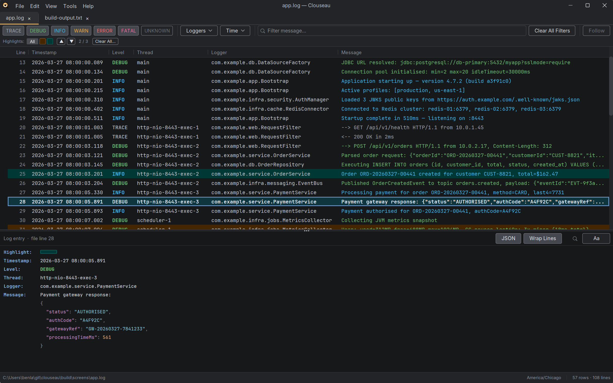
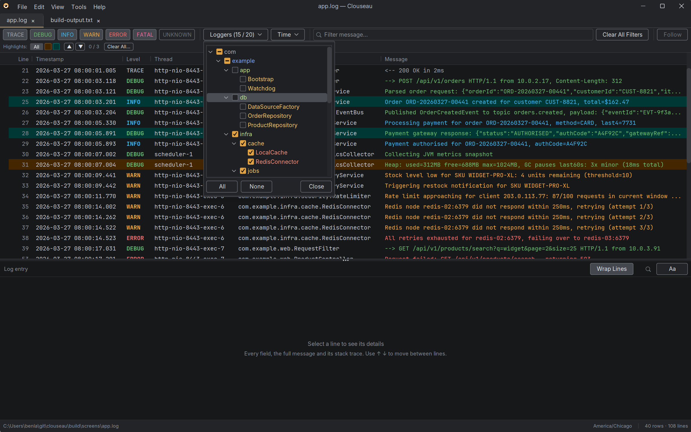

# Reading and filtering
{: .no_toc }

1. TOC
{:toc}

## The table

Each line of the log is a row with its timestamp, level, thread, logger and message. Rows
are colored by level, so errors and warnings stand out. Formats with extra fields (such as
a request ID or a process ID) get a column for each. Continuation lines, such as the lines
of a stack trace, stay with the entry they belong to.

The first column numbers the rows, and keeps each row's number when filters hide others:

- **Line**, on a file: the line in the file, as your editor counts it. Gaps are lines folded
  into the entry above (point at the number to see them, such as "Lines 66–75"), blank
  lines, or rows your filters hide.
- **#**, in a merged view: the row's place in the merged timeline. Its line in its own file
  is in the **Source** column, as `db.log:13`.
- **#**, on a live source: entries received since the tab opened.

The status bar shows the file's path, the [source timezone](#timezones), and how many rows
are shown from how many lines, such as **57 rows · 108 lines**.

- `Ctrl+Home` and `Ctrl+End` jump to the first and last row.
- Right-click a row to copy it, [highlight](#highlights) it, filter by its time or
  logger, or add a [note](annotations-and-review.md).
- **File → Reload File** (`Ctrl+R`) reads the file again from the start, keeping
  your filters and your column widths, order and hidden columns, and **Edit → Clear Table…** (`Ctrl+Shift+K`) empties the table.
- **Clear Table** empties the table so you see only what's written from now on, for example
  while you reproduce a bug. On a file, the rows are only hidden: new rows keep their line
  numbers in the file, your notes and highlights stay, and **Reload File** brings every row
  back. On an SSH or plugin source, the rows so far are removed. It isn't available on a
  merged view or a file shown as plain text.
- The **Edit** menu has the copy commands, Find (`Ctrl+F`, then `F3` / `Shift+F3` for the
  next and previous match) and notes for the selected row. The **View** menu has Follow,
  **Detail Pane** (Wrap Lines and text size, `Ctrl+=` / `Ctrl+-`), **Timezones…** and
  **Clear All Filters**.

## The detail panel

Select a row to see the whole entry below the table: every field, the full message and
its stack trace. The panel's header says where the entry is, even with the first column
hidden: **Log entry · file line 41**, **Log entry · db.log, line 41** in a merged view, or
**Log entry · #1042 since connecting** on a live source. It also holds the panel's controls:

- **JSON** appears when the message is JSON. Pressed (the default), the message is
  pretty-printed and colored; released, it's shown exactly as logged. Plugin formats get a
  button of their own in the same way.
- **Stack Trace** appears when the entry has a Java (or Kotlin, Scala, Groovy) stack trace.
  Pressed (the default), each exception and its **Caused by:** chain stand out, and frames
  from the JDK and common frameworks (Spring, Tomcat, Netty, Hibernate and the like) are
  dimmed, while the class and method of each frame from your own code are colored, so they're easy to spot. Released, the trace is shown in
  plain text.
- **toString** appears when the message holds an object's `toString()`: the
  `Order(id=12, items=[Item(sku=A, qty=2)])` of Lombok's `@ToString` and Kotlin data classes,
  `Point[x=1, y=2]` of records, `User{id=1, name='Bob'}`, and maps like `{user=bob, trace=abc}`.
  Pressed (the default), class names, keys and values are colored, and one too long for a line
  is spread over several, an entry per line, indented by depth. Released, it's shown as logged.
- **Collapsing.** A JSON object or array, or an object's `toString()`, that's spread over
  several lines has a small **▾** beside the line where it starts. Click it to fold the whole
  thing into one line, such as `"items": [ … 12 items ],`, and click the **›** or the
  `… 12 items` to open it again. Right-click the panel for **Collapse All** and **Expand
  All** (`Ctrl+Shift+-` and `Ctrl+Shift+=`). After Collapse All, opening an object shows
  what's inside it still collapsed, so you can open a big payload one level at a time. What
  you collapse stays collapsed while the entry is selected, even as a live log adds lines to
  it; the next entry you select opens in full. Copying always gives you the full text, never
  the `…`, and [Find in the entry](#find-in-the-entry) searches collapsed parts too.
- **Wrap Lines** wraps long lines to the panel's width instead of scrolling sideways (the same
  setting as in Settings).
- **Aa** opens the text size: **−** and **+** around the current size, and **Reset**. With
  the panel focused, `Ctrl`+mouse wheel, `Ctrl`+`+` and `Ctrl`+`-` change it too, and the new
  size shows briefly in the middle of the panel.
- The **search** button opens [Find in the entry](#find-in-the-entry).
- Drag the bar between the table and the panel to resize them. Files you open later start
  with the same split, even after a restart.

### Find in the entry

To search inside a long entry, such as a JSON payload or an HL7 message, click in the
panel and press `Ctrl+F`, or click the search button in its header. A find strip opens
under the header. (`Ctrl+F` with the table focused opens the table's find bar, which
searches every row.)

- It searches the entry as you see it: a pretty-printed JSON message is searched
  pretty-printed, and the field lines above the message are searched too.
- Matches inside a [collapsed](#the-detail-panel) object or list count too. Going to one
  opens it, and only it, so the rest of what you collapsed stays out of the way.
- Every match is marked, and the current one is boxed in amber and scrolled into view. The
  count shows which one it is, such as **2 / 5**.
- `Enter` or `F3` goes to the next match, `Shift+Enter` or `Shift+F3` to the previous one
  (or **▼** and **▲**, available while there are matches).
  Past the last match it goes back to the first, and a note in the middle of the panel says
  **↻ Back to the first match** (**↺ Back to the last match** going backwards).
  `Esc` closes the strip.
- When nothing matches, the search field turns red with a short pulse, and stays red until
  the text matches again. Pressing `Enter` or `F3` then says so in the middle of the panel:
  **No matches for "…"**, or why a regular expression isn't valid.
- **Aa** matches case. **.\*** treats the text as a regular expression, so `^OBX\|` finds
  every OBX segment of an HL7 message.
- The search stays when you select another row. Move through the table with `↑` `↓` and
  each entry opens at its first match, which makes it easy to compare one value across many
  lines. When no line is selected (after clearing the filters, say), the strip hides, and it
  comes back with your search when you select a line.
- If you selected text in the panel, `Ctrl+F` searches for it. Otherwise the strip starts
  with what the table's find bar is searching for, or with your last search here, found
  again as it opens.

### Jumping to the code

Every line of a Java (or Kotlin, Scala, Groovy) stack trace that names its file is a link:
in `at com.acme.OrderService.place(OrderService.java:42)`, **OrderService.java:42** is
underlined. Click it and your IDE opens `OrderService.java` at line 42. Right-clicking it
offers **Open OrderService.java:42 in IDE**, and when the entry's logger is named after its
class (`com.acme.OrderService`), the right-click menus of the panel and the table offer
**Open "OrderService" in IDE** too.

Choose your editor in **Settings → Source Code**:

- **JetBrains IDE** (the default): IntelliJ IDEA, or any other JetBrains IDE. Clouseau
  finds the file in your source folders, or in the projects open in the IDE, and the IDE
  opens it at the line. Frames from the JDK or a library aren't in your projects, so they
  can't be opened from Clouseau; a brief note says it can't open them, and why. If the file's project
  isn't open in the IDE, Clouseau says which project to open first, since the IDE can't
  navigate a file outside an open project; **Open File Anyway** opens it regardless, and
  brings the IDE to the front (on Linux that needs `wmctrl` or `xdotool` and an X11
  session). IntelliJ 2026.2 and later need JetBrains' free **IDE Remote Control** plugin (in the IDE:
  Settings → Plugins → Marketplace); Clouseau tells you if it's missing. Earlier versions
  have it built in.
- **VS Code** or **Cursor**: Clouseau finds the file in your source folders and opens it at
  the line. The first time, the editor asks whether to let another program open the file.

**Source folders** are where Clouseau looks for your code. If you keep your projects in one
of the usual places in your home folder, such as `git`, `src`, `repos` or `IdeaProjects`,
there's nothing to set up: Clouseau searches those, in every project and module
(`src/main/java` or elsewhere). Settings → Source Code shows which folders it found. To
search somewhere else, add your projects, or the folders that hold them, there; then only
those are searched.

If your source folders don't have the file, such as a frame in the JDK or a library, a note
in the middle of the panel says so.

Control characters in a field, such as a NUL byte or the escape that starts a terminal color
code, are shown dimmed as their symbols (`␀`, `␛`) so you can see they're there. Copying
still gives you the characters exactly as logged.

To copy an entry, right-click it in the table or in the panel, or use the Edit menu:
**Copy Message** (as shown), **Copy Raw Line** (the lines exactly as in the file, stack
trace included) and **Copy Entry** (every field, as shown). What you copied flashes, and a
note in the middle of the panel confirms it, such as "Raw lines copied (10 lines)".
Shortcuts work from the table or the panel: `Ctrl`+`C` copies the message (in the panel,
the text you've selected, if any), `Ctrl`+`Alt`+`C` the raw line and `Ctrl`+`Shift`+`C` the
entry. When you've selected text in the panel, its right-click menu
also offers **Copy** for that text.

## Filters

The filter bar narrows the table. All filters combine, and **Clear All Filters** resets
them.

- **Levels**: click a level button to hide or show it. `Alt`+click a level to show only
  that level; `Alt`+click it again to show all.
- **Loggers**: a tree of every logger in the file. Untick a package or class to hide its
  lines, or use **All** and **None**. The button shows how many loggers are shown, for
  example **Loggers (15 / 20)**.
  Right-click a row for **Hide Logger** or **Show Only Logger** (its logger, or those of
  all selected rows), and **Show All Loggers**, which says how many are hidden. Showing
  them all again leaves the other filters as they are.
- **Fields**: for formats with extra fields, untick values to hide their lines, or a
  field to hide or show all its values. The button shows a dot while a field filter is
  active.
- **Sources**: in a [merged view](merged-views.md), hide whole files.

These popups work from the keyboard too: the arrow keys move between rows (Left and Right
fold and unfold), `Space` ticks or unticks the row you're on, and `Esc` closes the popup.
- **Time**: a time range. The quickest way is from the table: right-click a line and
  choose **Show From This Line** or **Show Up to This Line**; do both to bracket an
  incident. Or click **Time** and fill in **From**, **To** or both, then press **Apply**
  or `Enter`; an empty field leaves that end open, and **Selected row** next to a field
  fills in the selected line's time. You can type:
  - just a time, `10:00` or `10:00:05` (with or without `.SSS` milliseconds), which means
    that time on the day the log starts;
  - a date and time, `yyyy-MM-dd HH:mm` or `yyyy-MM-dd HH:mm:ss`, or just a date. You
    can type or paste it as digits only and the separators go in as you type:
    `20261123030700` becomes `2026-11-23 03:07:00`;
  - a span counted from the other end: `+5m` in **To** means five minutes after **From**,
    and `-90s` in **From** means 90 seconds before **To** (`ms`, `s`, `m`, `h`, `d`).

  A time you leave short is filled out to the millisecond: the rest shows in gray as you
  type, and goes in when you press `Tab`, `Enter` or **Apply**. **From** gets the first
  moment of what you typed and **To** the last, so the day or minute you type in **To** is
  included whole: **To** `2026-11-23` means `2026-11-23 23:59:59.999`, and **To** `10:15`
  means `10:15:59.999`.

  While a range is set, the button shows it, for example **10:00:00 → 10:15:00**;
  **Clear** in the same popup removes it, and so does **Show All Times** when you
  right-click a line (it names the range it drops).
- **Filter message…**: show only lines whose message contains the text. Upper and lower
  case don't matter. The **×** at its right end clears it.
  - `&&` narrows it down: `request && id = 10 && value = 32` shows only messages that
    contain all three, in any order.
  - `|` widens it: `timeout|refused` shows messages that contain either.
  - Both work together: `request && id = (10|11)`.
  - Spaces around `&&` and `|` don't count, so `timeout | refused` is the same as
    `timeout|refused`. To match a `|` itself, write `\|`.
  - The text is also a [Java regular expression](https://docs.oracle.com/en/java/javase/21/docs/api/java.base/java/util/regex/Pattern.html),
    so `id = 10\b` matches `id = 10` but not `id = 100`. Characters such as `(`, `[`, `.`
    and `*` have special meanings; put a `\` before one to match it as it is.

Level, logger, field and time filters take milliseconds even on a million lines. A text
filter reads the text of the remaining rows in the background, and you can keep working.
If it takes more than a moment, a thin bar fills along the top of the rows and the rows
fade until the filtered ones replace them; the status bar also shows "filtering n%".

## Find

`Ctrl+F` (**Edit → Find…**) opens the find bar. It searches every column of the rows the filters show.
Closing it with `Esc` or **×** keeps your text: open it again and the same search runs at
once, with the text selected so typing replaces it.

- `Enter`, `F3` or **▼** goes to the next match, `Shift+Enter`, `Shift+F3` or **▲** to the
  previous one (the arrows are available while there are matches). `F3` works from the table too. Past the last match it goes back to the first,
  and a note over the rows says **↻ Back to the first match** for a moment (**↺ Back to the
  last match** going backwards), so you know you've seen every match. The note moves above or
  below the selected row rather than cover it.
- When no row matches, the search field turns red with a short pulse, and stays red until
  the text matches again. Pressing `Enter` or `F3` then says **No matches for "…"** over
  the rows.
- Each match is marked with a light box around the matching text, in every column, so a
  highlighted row keeps its color and still shows what matched. A short bar at the
  table's left edge marks every matching row, including one that matched only in a
  column you've hidden.
- The counter shows how many rows match ("Searching n%" while it's still counting). On a
  big file, the rows fade and the same thin bar as a filter's fills along the top of them
  while it searches.
- **Highlight ⌄** colors every match at once: pick one of the [highlight](#highlights)
  colors, or **None** (the first swatch) to uncolor them; it asks first when that's
  two or more rows, unless you turned that off in Settings. A ring marks what
  they all are already. Only rows the filters show are matched, so only those are colored.
- `Escape` closes the bar.

## Highlights

Highlights mark rows you want to come back to.

1. Select one or more rows, right-click, and pick a color.
2. The **Highlights** bar appears above the table. Click a color to step through only
   that color (or **All**), and use **▲** and **▼** to go to the previous or next
   highlighted row.
3. **None**, the first swatch, removes the color from the selected rows. To remove a
   whole color, right-click its chip in the bar and choose **Clear *color* Highlight**. **Edit → Clear All
   Highlights…**, or **Clear All** after the count in the bar, removes every
   highlight in the tab. Both take the rows the filters hide too, and ask first unless you
   turned that off in Settings.

Filters don't remove highlights, they only hide them. The bar stays while any row is
highlighted and says how many the filters hide: **2 / 4 · 3 hidden**, or **3 hidden by
filters** when none show (▲ and ▼ then have nowhere to go). A color whose rows are all
hidden shows a faded chip; point at a chip for its count, which also says how many are [auto-highlights](#auto-highlights).

Highlights are saved with the file's [notes](annotations-and-review.md), so they're back
when you open the file again, and they travel in review bundles. Each color follows the
current theme.

### Auto-highlights

An auto-highlight colors every row that matches it, in every log you open and in new rows
as they arrive while you follow a log. Use them for what you always want to spot:
`OutOfMemoryError` in red, a payment service's logger in blue, every warning about
timeouts in amber.

1. Open **Tools → Auto-Highlights…**, or, with a search in the [find bar](#find),
   **Highlight ⌄ → New Auto-Highlight…** to start from what you searched for.
2. Click **New Auto-Highlight** and fill it in:
   - **Text**: what to look for. **Aa** matches case, **.\*** reads it as a regular
     expression. Leave it empty to match on the level alone.
   - **Look in**: any column, or only the message, logger, thread or one field.
   - **Level**: only entries at this level or above (for example **WARN and above**).
   - **Color**: one of the eight highlight colors.
3. Rows change color as you type. Untick an auto-highlight in the list (or its **On** box)
   to turn it off without deleting it. Point at an auto-highlight in the list for its
   **Duplicate** and **Delete** (trash can) buttons; right-click it to move it up or down.

The first auto-highlight that matches a row gives it its color, so order matters:
right-click one to move it up or down, or press `Alt+↑` and `Alt+↓`. A line of a stack
trace that matches is colored, and so is the entry it belongs to, so you find the entry
even when its trace is filtered out.

Auto-highlight colors appear in the **Highlights** bar like your own, so ▲ and ▼ step
through them. Your own highlight on a row always wins. Auto-highlights aren't saved with
the file's notes or put in review bundles, and **Clear All** (shown while you have
highlights of your own) doesn't remove them: turn the auto-highlight off instead. While
auto-highlights color any rows, the bar has an **Auto-Highlights…** button that opens
them; so does **Edit Auto-Highlights…** in a chip's right-click menu. They're saved in
`highlight-rules.json` in the [data folder](settings.md#the-data-folder).

## Columns

Right-click any column header:

- **Columns**: tick or untick a column to show or hide it. **Show all columns** brings
  every column back.
- **Save current layout…** saves the order, visibility and width of the columns under a
  name. Pick a saved layout in the same menu to apply it.
- **Manage layouts…** deletes layouts, and sets one as the **default**, applied to every
  file you open. The default is marked ★. A layout fits merged views too: their extra
  Source column doesn't throw the other columns out of place.

Drag a column header to move the column. Columns size themselves to their content when a
file opens.

Click the **#** or **Timestamp** header to sort by it; click again to reverse it (newest
first), and a third time to go back to file order. Every table in Clouseau that sorts by
its headers works the same way. Sorting is instant even on a huge file or merged view. On a file whose times are out
of order, the rows settle into time order a moment after the click while the window stays
usable. A stack trace stays under its entry. The other columns don't sort: the filters
answer "only errors" or "only this thread" without losing the timeline.

With newest first on a log that's still growing, Follow keeps the top in view and new
lines appear there. Scroll down (or turn Follow off) and they're added above the view while
what you're reading stays where it is. See [Following live logs](following.md).

The columns always fill the window, so there's no horizontal scroll bar. **Message** takes
whatever room the other columns leave. Drag the border on a column's right to resize it,
and Message grows or shrinks to make up the difference. A message too long for its column
ends with **…**; the [detail panel](#the-detail-panel) shows all of it. If a window is so
narrow, or has so many columns, that Message would get very narrow, the table scrolls
sideways instead.

To fit the columns to their content, right-click a column header and choose **Fit columns
to content**. Each column becomes as wide as the longest value in the rows on screen, and
Message gets the rest of the room. Double-click the border on a column's right to fit just
that column; on Message's border, it fits all the others.

A log that gains a new field while you follow it gets a column for it, and your other
columns keep their widths, order and hiding.

## Timezones

Log timestamps usually don't say which timezone they're in, so Clouseau keeps two:

- **Written in** belongs to the log: the timezone its timestamps were written in. It
  starts as your computer's timezone and is remembered for each file. A timestamp that
  says its own offset, such as `2026-03-27T08:00:00Z` or `+02:00` in a JSON log, already
  says when it happened, so **Written in** doesn't change it.
- **Show times in** belongs to you: the timezone every tab shows times in, and the one the
  **Time** filter's **From** and **To** use. It's the same setting as in
  [Settings](settings.md). Change it while a time range is set and the range keeps its
  text, now read in the new timezone, and the rows are filtered again to match.

The status bar shows them at the right: just `America/Chicago` when a log is read and shown
in the same timezone, or `UTC → America/Chicago` when it's read in one and shown in
another (`Per file → …` in a merged view whose files have different ones). Point at it to
see how far apart they are.

Click it (or choose **View → Timezones…**) to change either. Type in a
timezone box to search it: "chic" finds America/Chicago. Your computer's timezone and UTC
are listed first, then the ones you've used lately. Tick **Same for all open tabs** to read
every open tab, in every window, in the same timezone; otherwise only this tab changes.
Changing **Written in** reloads the log. In a merged view, the timezone you choose applies
to all its files; to set one file's, right-click the tab and use **Sources**.

When a log is read in one timezone and shown in another, the detail panel adds **In the
file** under the timestamp: the time as the file has it, in its own timezone, so you can
check it against the raw line.
